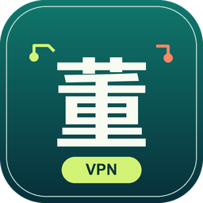

# Dong VPN

> A macOS menu-bar client for a self-managed Xray server using VLESS + REALITY.

<p align="center"><br><a href="https://52.34.245.131:8443"><strong>Download Dong VPN for macOS</strong></a></p>

The download page requires a password. Request access by emailing [Dong VPN support](mailto:simondong0919@gmail.com).

## Overview

Dong VPN bundles the Xray client and manages a local connection from the macOS menu bar. It verifies the tunnel before enabling the system proxy, reports the public IP reached through the tunnel, and reconnects after network interruptions.

## Features

- One-click connect and disconnect from the menu bar
- Automatic connection at launch and optional login startup
- Tunnel checks, reconnects, and recovery after Xray exits
- Automatic selection of an available local SOCKS port
- English and Chinese interface, based on the Mac's preferred language
- Restores the proxy settings that were active before connecting

## Install

1. Open the [Dong VPN download page](https://52.34.245.131:8443) and enter the password provided by the owner.
2. Open the downloaded DMG and drag Dong VPN to Applications.
3. Open Dong VPN. Because the app is unsigned, macOS may ask you to approve it in **System Settings > Privacy & Security**.

The app is named **Dong VPN** in Applications and moves itself there if opened from another location.

## How It Works

DongVPN starts the bundled Xray process and routes eligible macOS network services through the local SOCKS proxy. Mainland China destinations and local network addresses are configured to connect directly. The tunnel check requests a public IP through Xray before enabling the system proxy.

This is not a native macOS Network Extension VPN. Apps that ignore the system SOCKS proxy and UDP traffic may bypass the connection.

## Build

Build on macOS 12 or later with Xcode:

```sh
xcodebuild -project XrayVPN/XrayVPN.xcodeproj -scheme XrayVPN -configuration Release
```

The macOS GitHub Actions workflow builds an unsigned DMG and bundles Xray for Apple silicon and Intel. When configured, `DONGVPN_VLESS_LINK` is embedded in the app built by Actions. Keep real links in the repository secret only; anyone who receives a configured app can extract its server configuration. The workflow does not publish DMGs or create GitHub releases.

## Optional Server Deployment

`deploy.sh` provisions a Lightsail VM and runs `server-setup.sh`. It requires the AWS CLI and creates billable cloud resources. Resource names and region can be set with `DONGVPN_INSTANCE_NAME`, `DONGVPN_KEY_NAME`, `DONGVPN_STATIC_IP_NAME`, `DONGVPN_AWS_REGION`, and `DONGVPN_AWS_AZ`. The generated connection link and SSH key are written under ignored `out/` and `keys/` directories.

`destroy.sh` removes the resources selected by those same settings. Review the names and AWS account before running it.

## Security

- Treat the download password and VLESS link as credentials. Share them only with people you trust.
- The password gate controls access to the download page; it does not encrypt or revoke a DMG after download.
- Keep generated keys, links, server state, and web configuration out of Git. The repository ignores local `keys/`, `out/`, and website secrets.
- A public release or a copy of the DMG can expose the embedded VLESS link. Rotate the server credentials if a build is shared beyond its intended audience.

## Support

For download access or connection help, email [simondong0919@gmail.com](mailto:simondong0919@gmail.com). Issues and discussions on this public repository are visible to everyone; use email for private requests.

### Website deployment

`website/deploy.sh` deploys the download page to the existing Lightsail host. Set `DONGVPN_SSH_TARGET`, `DONGVPN_SSH_KEY`, and `DONGVPN_PUBLIC_URL` in the shell, then run `bash website/deploy.sh`. The SSH key and server configuration stay outside Git. Set `DONGVPN_DMG_PATH` only when intentionally replacing the downloadable app.

The app icon source is `XrayVPN/XrayVPN/DongVPN-logo.svg`; its macOS icon sizes are generated with `python3 -m pip install Pillow && python3 XrayVPN/tools/render_app_icon.py`.

## License

No license file is included. Contact the maintainer before redistributing or reusing this project.
