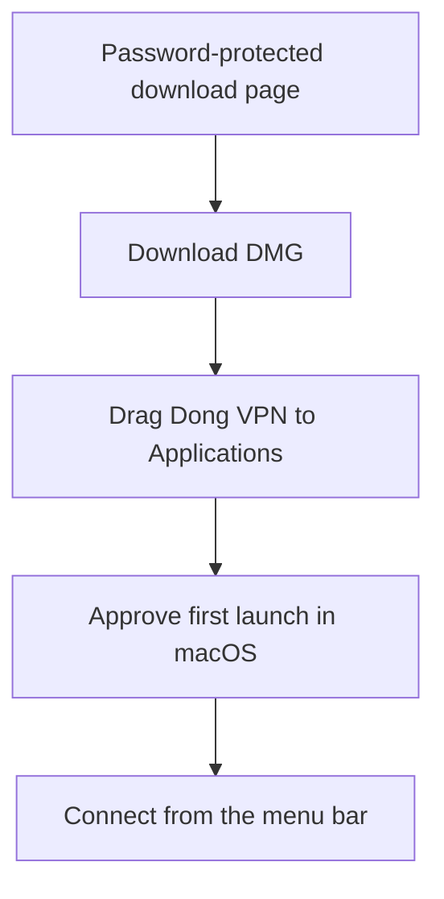
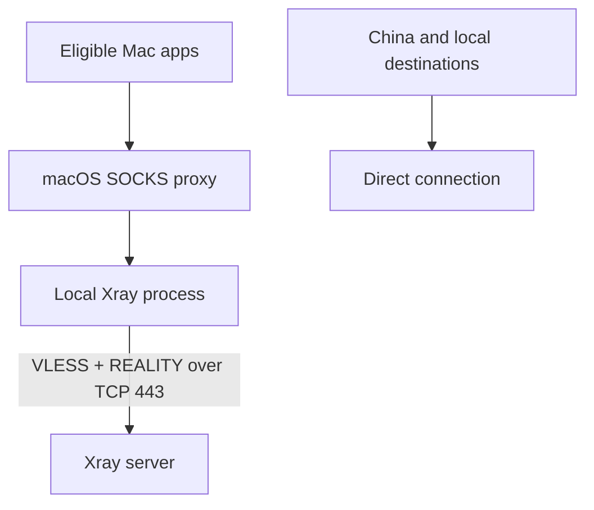

# Dong VPN

> A macOS menu-bar client for a self-managed Xray server using VLESS + REALITY.

<p align="center">
  <br>
  <a href="https://52.34.245.131:8443"><strong>Download Dong VPN for macOS</strong></a>
</p>

**macOS 12 or later** · The password-protected download page includes a bilingual installation guide.

## Install



The app is unsigned, so macOS may require approval in **System Settings > Privacy & Security**. The download page explains the first-launch steps.

In Applications, search for **Dong VPN**.

## Connection



This uses the macOS system SOCKS proxy, not a Network Extension. Apps that ignore system proxy settings and UDP traffic may bypass the tunnel. Dong VPN checks the public IP through Xray before enabling the proxy.

## Features

| Area | Behavior |
| --- | --- |
| Connection | Connect, disconnect, auto-connect at launch, and optional login startup |
| Reliability | Tunnel checks, retry after interruptions, and recovery if Xray exits |
| Local proxy | Selects an available SOCKS port automatically |
| Routing | Mainland China and local network destinations connect directly |
| System settings | Restores the proxy settings that were active before connecting |
| Interface | English or Chinese, based on the Mac's preferred language |

## Build

Build on macOS 12 or later with Xcode:

```sh
xcodebuild -project XrayVPN/XrayVPN.xcodeproj -scheme XrayVPN -configuration Release
```

Regenerate the app icon with `python3 -m pip install Pillow && python3 XrayVPN/tools/render_app_icon.py`.

GitHub Actions builds an unsigned DMG with Xray for Apple silicon and Intel. It does not retain or publish the DMG. Set the `DONGVPN_VLESS_LINK` repository secret to embed a VLESS link in an Actions build. Anyone with a configured DMG can extract that link.

## Server and website

| Task | Command or configuration |
| --- | --- |
| Provision Lightsail | `deploy.sh` (requires AWS CLI and creates billable resources) |
| Configure resources | `DONGVPN_INSTANCE_NAME`, `DONGVPN_KEY_NAME`, `DONGVPN_STATIC_IP_NAME`, `DONGVPN_AWS_REGION`, `DONGVPN_AWS_AZ` |
| Deploy website | Set `DONGVPN_SSH_TARGET`, `DONGVPN_SSH_KEY`, and `DONGVPN_PUBLIC_URL`, then run `bash website/deploy.sh` |
| Replace the hosted DMG | Also set `DONGVPN_DMG_PATH` before deploying |
| Remove Lightsail resources | `destroy.sh`; verify the resource names and AWS account first |

Generated links and keys are stored in ignored `out/` and `keys/` directories. Website configuration is also excluded from Git.

## Security

| Keep private | Why |
| --- | --- |
| Download password | It gates the website, but does not protect a DMG after download |
| VLESS link | A configured app contains an extractable server credential |
| Keys and web configuration | Keep generated files and deployment credentials out of Git |

Rotate server credentials if a configured DMG is shared beyond its intended audience.

## Support

For download access or connection help, email [simondong0919@gmail.com](mailto:simondong0919@gmail.com). Public issues and discussions are visible to everyone.

## License

No license file is included. Contact the maintainer before redistributing or reusing this project.
