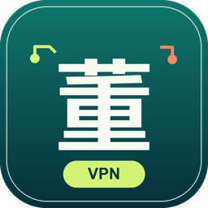
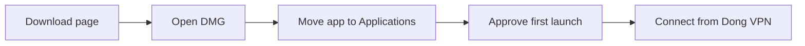
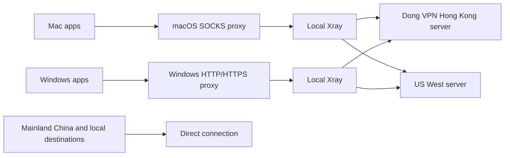

# Dong VPN

<p align="center">
  <br>
  <a href="https://52.34.245.131:8443"><strong>Download Dong VPN</strong></a><br>
  Password-protected downloads for macOS
</p>

macOS 12+ menu-bar app and a Windows desktop client for a self-managed Xray server using VLESS + REALITY.

## Install



The macOS app is unsigned, so Gatekeeper may ask for approval in **System Settings > Privacy & Security**. The Windows build is currently local-only; run `python Windows/build.py` to create `out/dongvpn-release/DongVPN.exe`.

## Connection



Hong Kong runs on a dedicated AWS EC2 address, not a shared VPN hub. The address still belongs to an AWS data-center network, so some websites may flag or block it. No provider can guarantee that a site will accept a particular IP.

When a client selects Hong Kong, it requests a short lease and starts the stopped server. The client checks the public IP before enabling its system proxy. Disconnect releases the lease; a scheduled task stops the server once no client leases remain. If a client crashes, its lease expires after three minutes, followed by at most about one minute before the next stop check.

Both clients use system proxy settings rather than a full-device VPN tunnel. Apps that ignore the system proxy, and UDP traffic, may bypass the connection. The Windows client routes HTTP and HTTPS through its local Xray proxy and restores the previous Windows proxy values when disconnected.

## Build

Build the macOS app on macOS 12+ with Xcode:

```sh
xcodebuild -project XrayVPN/XrayVPN.xcodeproj -scheme XrayVPN -configuration Release
```

GitHub Actions embeds server settings from repository secrets: `DONGVPN_VLESS_LINK`, `DONGVPN_HK_VLESS_LINK`, `DONGVPN_CONTROL_URL`, and `DONGVPN_CONTROL_TOKEN`. A successful build from `master` deploys its configured DMG to the password-protected site; it is not uploaded as a public GitHub artifact. Server credentials can be extracted from either app.

Build the Windows client on Windows after provisioning the private files listed by the build script:

```powershell
python -m pip install Pillow PyInstaller requests certifi
python Windows/build.py
```

The build verifies the official Xray release digest before packaging it. Generated profiles, controller credentials, and executables stay under ignored `out/`.

## Support

For download access or connection help, email [simondong0919@gmail.com](mailto:simondong0919@gmail.com). Do not post VLESS links, tokens, or connection logs containing credentials in public issues.

## License

No license file is included. Contact the maintainer before redistributing or reusing this project.
